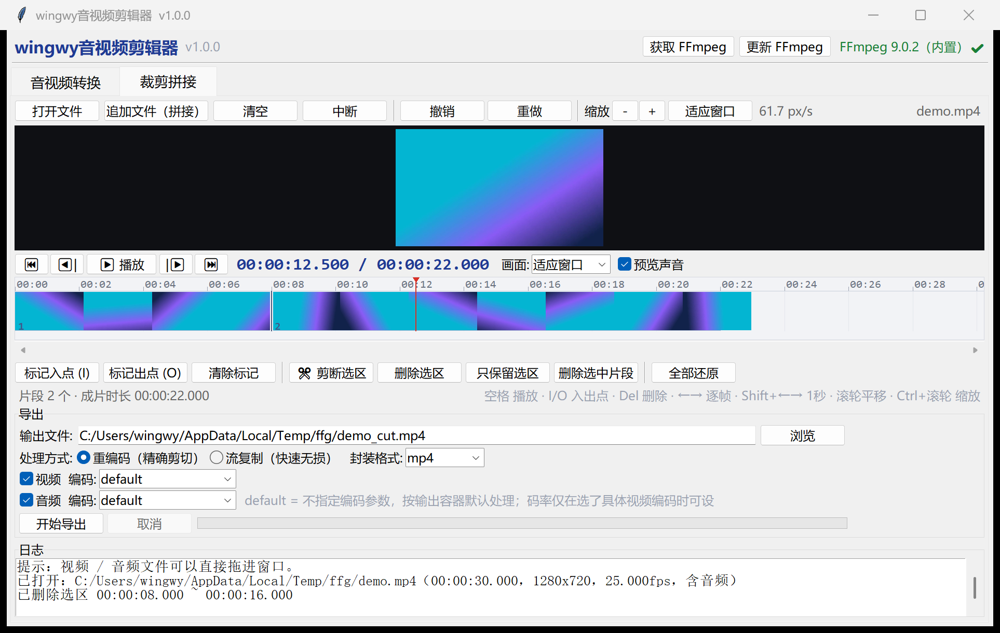
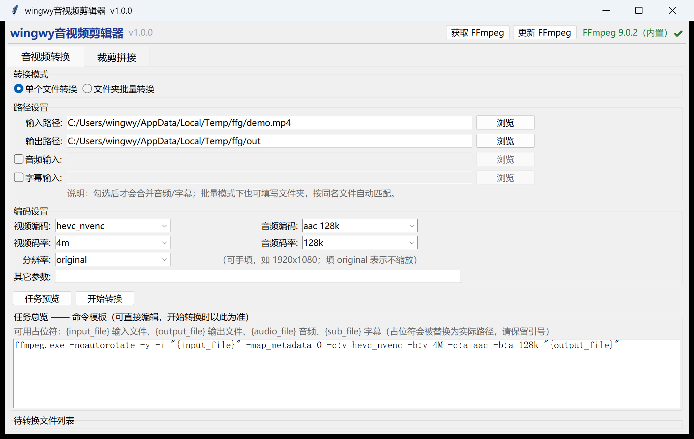
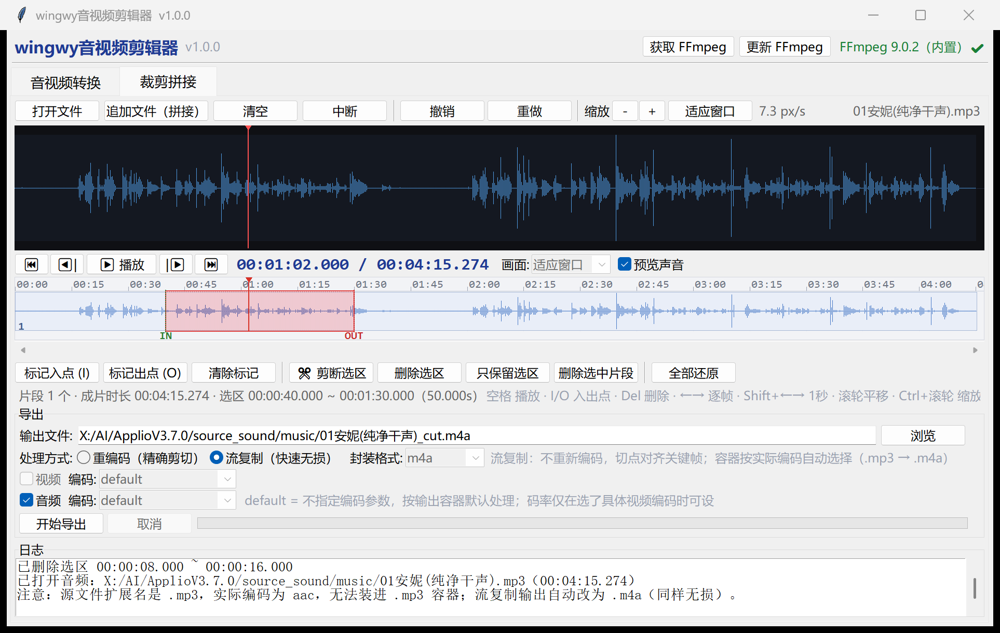

# wingwy音视频剪辑器 (wingwy Media Editor)

> 基于 Python + Tkinter + FFmpeg 的 Windows 桌面工具：**批量转换** + **播放器式无损剪辑**。
> 单文件 exe（`wingwy-media-editor.exe`），绿色免安装，FFmpeg 可在程序内一键下载。

> 仓库名与可执行文件名统一使用英文 `wingwy-media-editor`，程序内显示名为「wingwy音视频剪辑器」。



---

## 功能

### 一、音视频转换

- 单个文件 / 文件夹批量转换
- 视频编码、视频码率、分辨率、音频编码、音频码率均可下拉选择，也可手动填写（如 `1920x1080`、`4M`、`192k`）
- 可选合并外部音频、字幕（批量模式下按同名文件自动匹配）
- **命令模板可编辑**：生成后可直接改命令行，开始转换以模板为准
- 支持 `{input_file}` `{output_file}` `{audio_file}` `{sub_file}` 占位符



### 二、裁剪拼接（剪辑台）

按 AU / PR 的简化思路做的：上面是播放器，下面是可缩放时间轴。

- **预览**：逐帧、拖动定位、播放；音频素材自动切换成大波形视图，视频可 10% / 25% / 50% / 100% / 150% / 200% / 400% 缩放（Ctrl+拖动平移）
- **时间轴**：缩略图 / 波形平铺、片段分界、播放头、入出点标记；Ctrl+滚轮缩放、滚轮平移、适应窗口
- **剪辑**：I / O 标记入出点，Shift+拖动直接拖出选区，剪断选区、删除选区（ripple）、只保留选区、删除选中片段、撤销 / 重做
- **拼接**：视频 / 音频文件直接拖进窗口，或用「追加文件」接在末尾；不同分辨率自动缩放补边
- **导出**：
  - **重编码（精确剪切）**：可选封装格式 mp4 / mkv / mov / webm / ts（纯音频为 mp3 / m4a / wav / flac / aac / ogg），编码可留 `default` 交给容器默认
  - **流复制（快速无损）**：`-c copy` + concat 分离器，全程不重新编码，速度接近磁盘拷贝
  - 视频、音频可分别勾选，只导视频或只导音频都行
  - 无音轨的片段自动补静音，导出时长与时间轴严格一致



---

## 快速开始

### 方式一：直接用 exe（推荐）

1. 到 [Releases](../../releases) 下载 `wingwy-media-editor.exe`
2. 放到任意文件夹，双击运行（Windows 10 / 11，无需安装 Python）
3. 首次运行如果右上角提示「未检测到 FFmpeg」，点 **获取 FFmpeg**，程序会自动下载官方构建并装到同目录（约 115 MB）

### 方式二：源码运行

```bash
python wingwy_media_editor.py
```

要求 Python 3.8+（自带 tkinter），并把 `ffmpeg.exe` / `ffprobe.exe` / `ffplay.exe` 放在程序同目录，或加入系统 PATH。

---

## FFmpeg 说明

程序按以下顺序查找 FFmpeg：

1. 程序（或 exe）同目录下的 `ffmpeg.exe`
2. 系统 PATH 中的 `ffmpeg`

右上角会实时显示检测结果，例如 `FFmpeg 9.0.2（内置）✔`，未找到时显示红色提示。

- **获取 FFmpeg**：下载 [gyan.dev](https://www.gyan.dev/ffmpeg/builds/) 官方 Windows 构建并解压安装到程序目录
- **更新 FFmpeg**：先比对线上版本号，已是最新会直接提示，不会重复下载

> 下载过程有进度条和速度显示，可随时取消。安装前会先停掉正在运行的 ffmpeg，避免文件占用。

---

## 快捷键（裁剪拼接页）

| 按键 | 功能 |
| --- | --- |
| `空格` | 播放 / 暂停 |
| `I` / `O` | 标记入点 / 出点 |
| `Shift + 拖动` | 直接拖出选区 |
| `Delete` / `Backspace` | 删除选区（无选区时删除选中片段） |
| `←` / `→` | 逐帧 |
| `Shift + ←` / `→` | 前后 1 秒 |
| `Home` / `End` | 跳到开头 / 结尾 |
| `Esc` | 清除标记 |
| `Ctrl + Z` / `Ctrl + Shift + Z` | 撤销 / 重做 |
| `滚轮` / `Ctrl + 滚轮` | 时间轴平移 / 缩放 |
| `Ctrl + 拖动`（预览区） | 画面平移（放大时） |

---

## 关于「流复制（快速无损）」

流复制不做任何重编码，画质零损失，速度基本等于拷贝文件，但有两点需要知道：

1. **只能切在关键帧上**。时间轴标尺上的橙色小刻度就是关键帧位置，按 I / O 标记时会自动吸附到最近的关键帧；如果切点不在关键帧上，导出会从上一个关键帧开始，日志里会提示。
2. **各片段编码参数必须一致**（编码、分辨率、帧率、采样率）。不一致时程序会提示改用重编码，不会产出坏文件。

另外，输出容器按**真实编码**自动选择，不看扩展名——比如扩展名是 `.mp3`、实际内容是 AAC 的文件，流复制会自动输出 `.m4a`，并在界面上提示 `（.mp3 → .m4a）`。

---

## 从源码打包 exe

```bash
pip install pyinstaller
pyinstaller --noconfirm --clean --onefile --windowed --name wingwy-media-editor wingwy_media_editor.py
```

也可以直接双击 `build_exe.bat`。产物在 `dist/` 下，约 11 MB（**不含** FFmpeg，运行时由「获取 FFmpeg」下载）。

---

## 发布新版本（自动）

仓库带了 GitHub Actions 流水线 `.github/workflows/release.yml`：**推一个 tag，就自动在 Windows 环境打包并发布 Release**，不需要手动上传 exe。

```bash
git tag v1.0.1
git push origin v1.0.1
```

约 2～3 分钟后，`Releases` 页面会出现新版本，并挂上 `wingwy-media-editor.exe`。
构建进度可以在仓库的 **Actions** 标签页查看；也可以在 Actions 里手动触发（只构建，不发布）。

---

## 已知限制

- 预览播放是 15fps 的静音画面（声音由 ffplay 单独播放），用于对位找点，不作为审片用途
- 流复制在段边界可能打印 `Non-monotonic DTS` 告警，ffmpeg 会自动修正时间戳，不影响播放与时长
- 自动下载 FFmpeg 仅支持 Windows；其他平台请手动安装
- 界面基于 Tkinter，样式朴素，功能优先

---

## License

[MIT](LICENSE)
